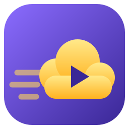
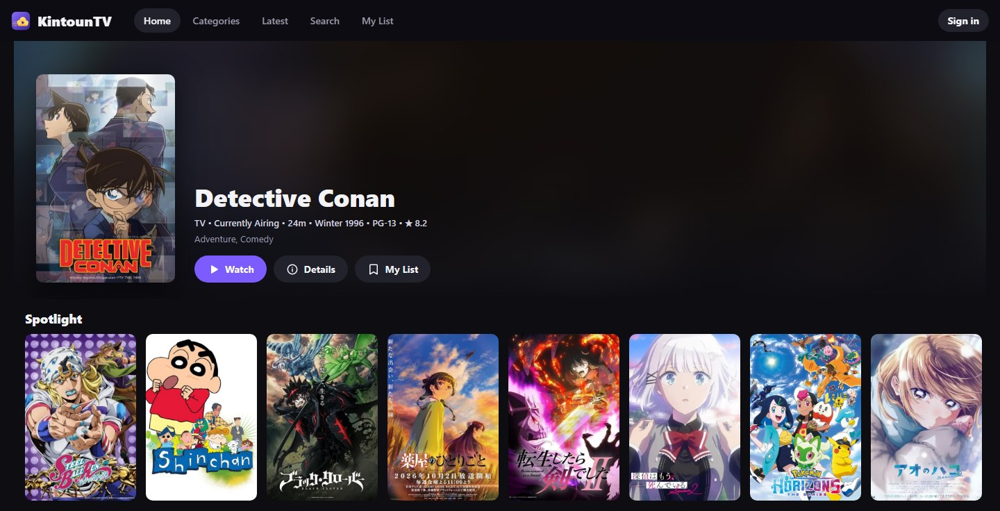
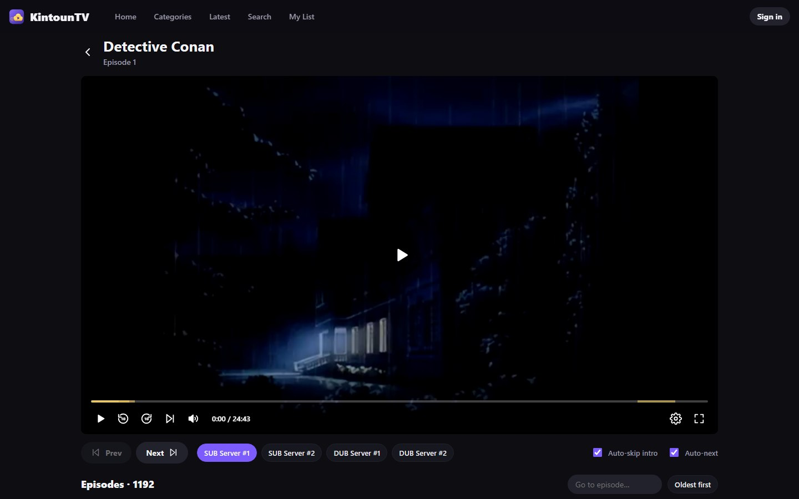
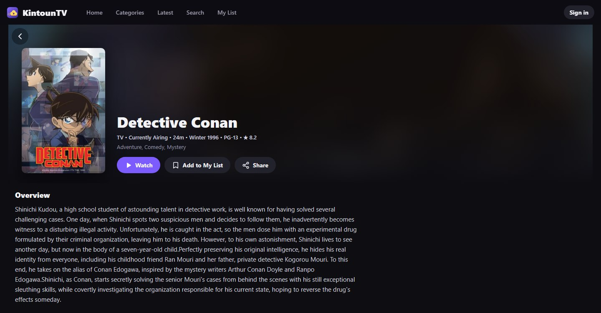
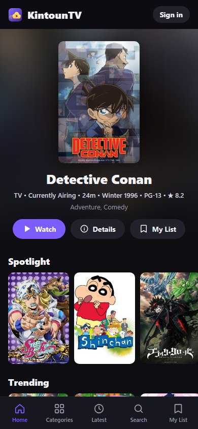

<div align="center">



# KintounTV

**Ad-free anime streaming for Windows and Android: an in-app player, automatic intro skipping and
cross-device sync.**

[](https://github.com/Preygle/KintounTV/releases/latest)
[](https://github.com/Preygle/KintounTV/blob/stats/DOWNLOADS.md)
[](https://github.com/Preygle/KintounTV/blob/stats/DOWNLOADS.md)
[](https://github.com/Preygle/KintounTV/blob/stats/DOWNLOADS.md)
[](https://github.com/Preygle/KintounTV/actions/workflows/ci.yml)

[**Download for Windows**](https://github.com/Preygle/KintounTV/releases/latest/download/KintounTV.exe)
&nbsp;·&nbsp;
[**Download for Android**](https://github.com/Preygle/KintounTV/releases/latest/download/KintounTV.apk)
&nbsp;·&nbsp;
[All releases](https://github.com/Preygle/KintounTV/releases)



</div>

*Kintoun* (筋斗雲) is the Flying Nimbus from Dragon Ball: hop on and go.

## Features

- **Watch in the app.** No external player, no ads, no pop-ups and no analytics.
- **A real player.** Quality selection, subtitles when the stream has them, playback speed,
  keyboard shortcuts, and true fullscreen with controls that hide while you watch.
- **Skips intros, recaps and credits** automatically, using community timings from
  [AniSkip](https://aniskip.com). Turn it on or off right under the player.
- **Binge mode.** Next episode and auto-next keep you in fullscreen. If a server fails, the next
  SUB/DUB server takes over automatically.
- **Continue Watching and History.** Pick up where you left off, with history grouped by day.
- **Sync across devices.** Sign in with a username and password once, and My List and history follow
  you between Windows and Android.
- **Light.** The Windows app is 7.5 MB and starts instantly; the Android app is 0.2 MB.

## Screenshots

| Player | Details | Phone |
| :---: | :---: | :---: |
|  |  |  |

## Install

### Windows 10 / 11

1. Download [`KintounTV.exe`](https://github.com/Preygle/KintounTV/releases/latest/download/KintounTV.exe).
2. Run it. There is no installer: put it anywhere and pin it to Start or the taskbar.
3. If Windows SmartScreen warns about an unrecognized app, choose **More info → Run anyway**. The
   app isn't code-signed yet.

It uses the Microsoft Edge WebView2 Runtime, which comes with Windows 11 and current Windows 10.

### Android 7+

1. On your phone, download [`KintounTV.apk`](https://github.com/Preygle/KintounTV/releases/latest/download/KintounTV.apk).
2. Open it and allow your browser to install apps when Android asks.

### Verify a download (optional)

Each release includes `SHA256SUMS.txt`. Compare it with `certutil -hashfile KintounTV.exe SHA256`
on Windows, or `sha256sum KintounTV.apk` elsewhere.

## Download stats

Downloads of every release file are recorded per platform:

- **Badges** at the top of this page show all-time Windows, Android and total downloads.
- **[DOWNLOADS.md](https://github.com/Preygle/KintounTV/blob/stats/DOWNLOADS.md)** breaks them down by
  release, with the last 30 days.
- **[history.csv](https://github.com/Preygle/KintounTV/blob/stats/history.csv)** keeps one row per day,
  ready for a spreadsheet.

The [Download stats workflow](.github/workflows/download-stats.yml) reads the counts from GitHub's
releases API every 6 hours and whenever a release is published, and commits them to the `stats`
branch. To see live numbers yourself:

```sh
gh release view --repo Preygle/KintounTV --json assets --jq '.assets[] | "\(.name): \(.downloadCount)"'
```

## Using the player

| Key | Action |
| --- | --- |
| <kbd>Space</kbd> / <kbd>K</kbd> | Play / pause |
| <kbd>←</kbd> / <kbd>J</kbd>, <kbd>→</kbd> / <kbd>L</kbd> | Back / forward 10 seconds |
| <kbd>↑</kbd> / <kbd>↓</kbd> | Volume |
| <kbd>M</kbd> | Mute |
| <kbd>F</kbd> or double-click | Fullscreen |
| <kbd>N</kbd> / <kbd>P</kbd> | Next / previous episode |

Quality, speed, subtitles and skip behaviour are under the ⚙ button. **Auto-skip intro** and
**Auto-next** are under the player. When skipping is off, a **Skip** button still appears during
intros and credits.

## Accounts and sync

Accounts are optional; everything works signed out, saved on the device. Sign in from the top-right
corner with a **username** and **password**, and use the same details on your other devices. Use an
email address as the username if you want **Forgot password** to work.

Each device signs in once. My List syncs a few seconds after a change, and watch progress about once a
minute while you watch. Other devices pick up changes when they're opened. Data is stored with
Firebase, and each account can only read its own data.

## Build from source

Requirements: [Node.js](https://nodejs.org) 20+ and [Go](https://go.dev) 1.24+ for Windows; the
Android SDK (`platforms;android-35`, `build-tools;35.0.0`) and JDK 17+ for Android.

```sh
npm install
npm run dev               # web app with hot reload: http://localhost:5173
npm run desktop:build     # -> desktop/bin/KintounTV.exe
npm run desktop:install   # build, install to %LOCALAPPDATA%\Programs\KintounTV, add a Desktop shortcut
npm run android:build     # -> android/build/KintounTV.apk  (add -- --debug for a debuggable build)
npm run build && npm start   # web app in production mode: http://localhost:4173
```

**Sync in your own builds.** It needs a Firebase project. Copy `.env.example` to `.env.local` and fill
in its `apiKey` and `projectId`; see [docs/ARCHITECTURE.md](docs/ARCHITECTURE.md#sync) for the
one-time setup and security rules. Without them, the app runs normally with sync turned off.

**Releasing.** Bump `version` in `package.json`, add a section to [CHANGELOG.md](CHANGELOG.md), commit,
then run `npm run release`. It builds both apps, writes checksums, tags the version and publishes the
GitHub release. The Android release key is created on the first build under
`%LOCALAPPDATA%\KintounTV\android`. Back it up: updates must be signed with the same key.

## Project layout

```
src/            web app (React + TypeScript + Vite): pages, player, sync
desktop/        Windows app: Go + WebView2 shell, local API/stream server, icon and version info
android/        Android app: WebView shell and local server in Java, built with the plain SDK tools
scripts/        release script
docs/           architecture notes and screenshots
server.mjs      Node server for the web app (static files + /api + streaming)
```

How it works, including the catalog API, the streaming chain and intro-skip matching, is described in
[docs/ARCHITECTURE.md](docs/ARCHITECTURE.md).

## Disclaimer

KintounTV does not host any video. It is a client for catalog and streaming services run by third
parties, and plays what they provide. Availability depends on those services, and some networks (for
example campus web filters) block them. This project is not affiliated with any of them, or with the
owners of Dragon Ball.
